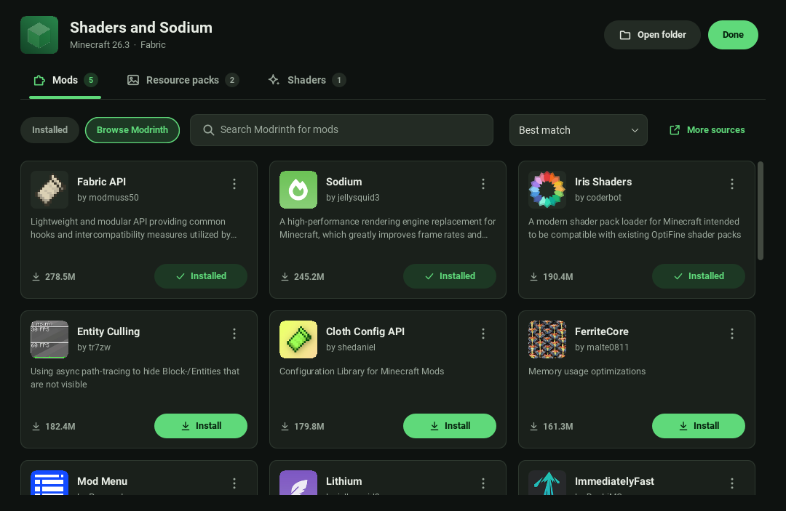
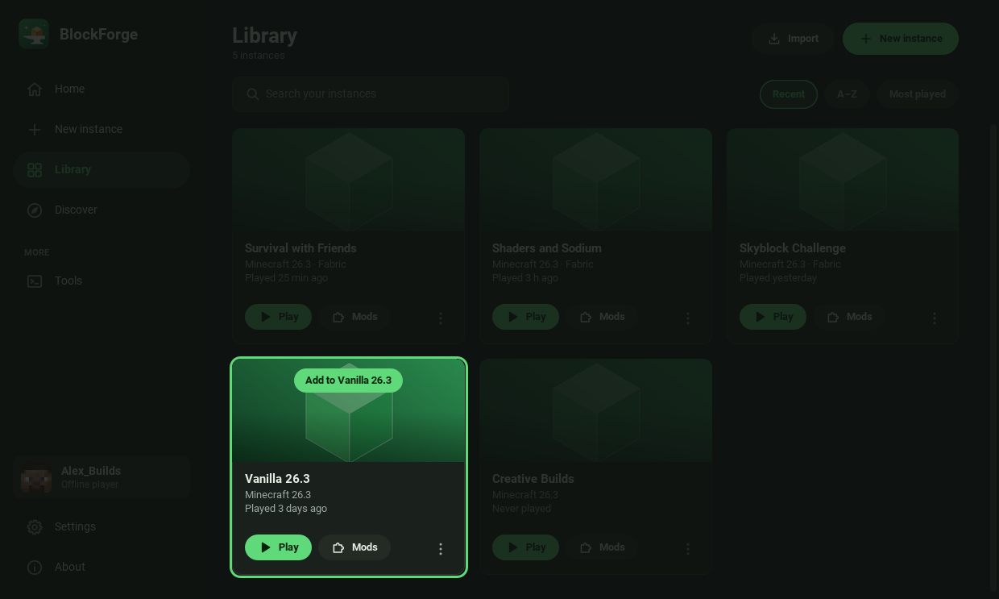
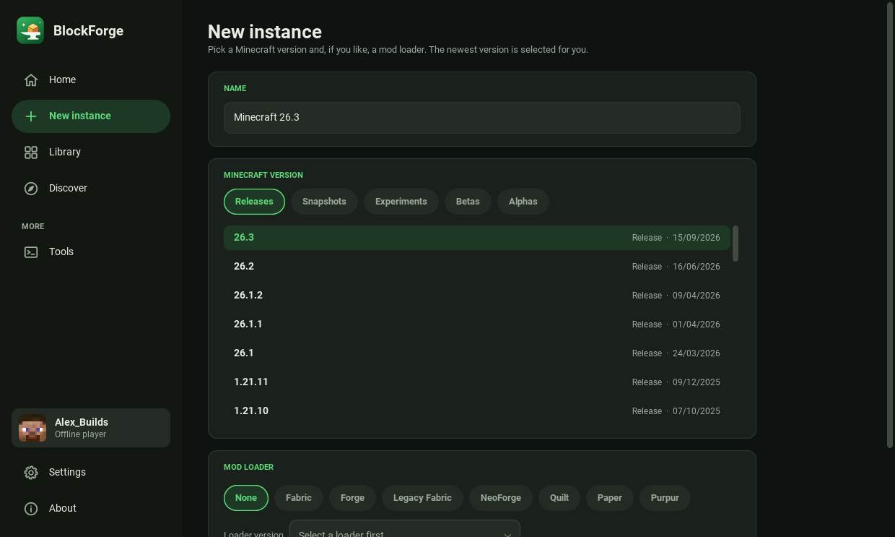
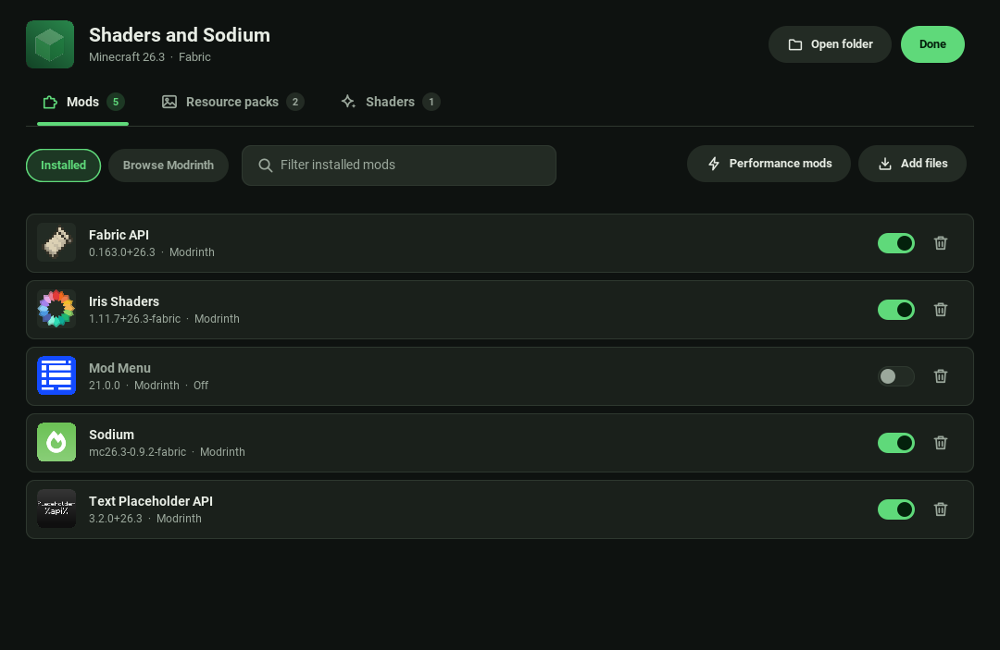
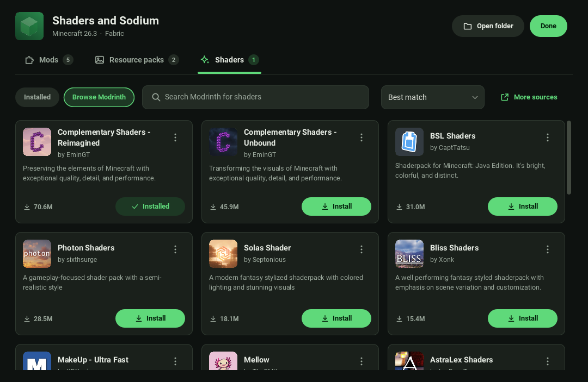
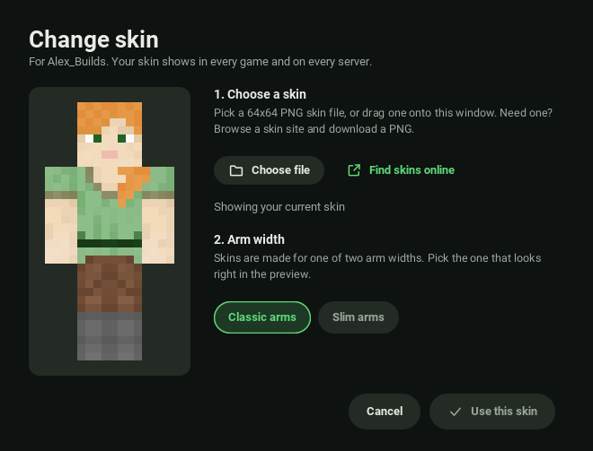
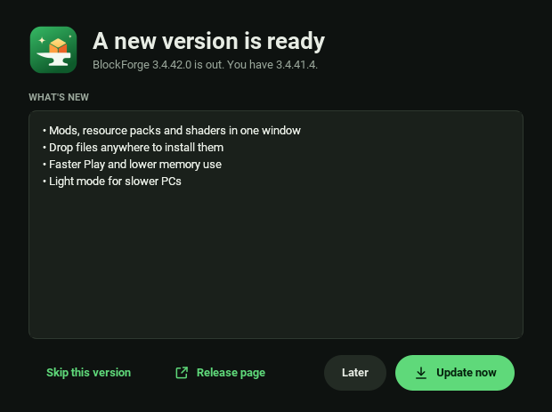
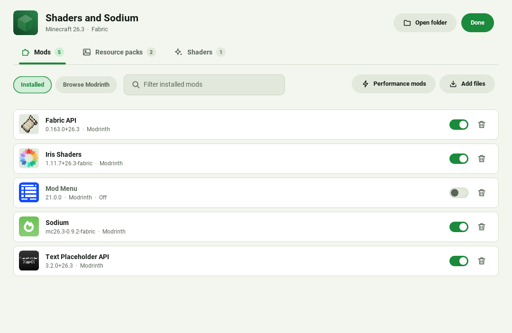

<p align="center">
  <picture>
    <source media="(prefers-color-scheme: dark)" srcset="docs/logo/banner-dark.svg">
    
  </picture>
</p>

<p align="center">
  <b>A fast, modern Minecraft launcher. Play offline without an account, install mods with one click, and run well on
  low-end PCs.</b>
</p>

<p align="center">
  <a href="https://github.com/riyadmondol2006/BlockForge/actions/workflows/build.yml"></a>
  <a href="https://github.com/riyadmondol2006/BlockForge/releases/latest"></a>
  <a href="LICENSE"></a>
  <a href="https://github.com/riyadmondol2006/BlockForge/releases"></a>
</p>

<p align="center">
  <a href="https://github.com/riyadmondol2006/BlockForge/releases/latest"></a>
</p>

<p align="center">
  Windows &middot; macOS (Apple Silicon and Intel) &middot; Debian/Ubuntu &middot; Fedora<br>
  Java is included in the installers, so there's nothing else to install.
</p>

> **BlockForge is a fork of [ATLauncher](https://github.com/ATLauncher/ATLauncher)** (GPL-3.0). The launcher's core
> (modpack installs, mod loaders, instance handling, account and launch code) comes from ATLauncher and its
> contributors, and their copyright notices are kept in the source. See
> [What's different](#whats-different-from-atlauncher) for what this fork changes. BlockForge is not affiliated with or
> endorsed by ATLauncher, Mojang or Microsoft.

## Why BlockForge?

- **Play offline, no account needed.** BlockForge asks who's playing when it opens: type any name to play offline, pick a
  saved player, or sign in with Microsoft. Signing in is optional.
- **A modern, clean interface.** A sidebar with Home, Library, Discover and Settings, dark and light looks, and a Home
  screen that puts your last-played instance one click away.
- **Mods, resource packs and shaders in one window.** Browse Modrinth and install with one click. Mods a mod needs come
  along automatically, and adding a shader offers to set up Iris and Sodium (or Oculus on Forge) for you.
- **Drag and drop anything.** Drop a mod, resource pack, shader, data pack or whole modpack anywhere on the window.
  BlockForge looks inside the file, works out what it is and puts it in the right place.
- **Quick to open, quick to play.** The window opens sooner, and pressing Play starts the game almost straight away
  because files that haven't changed aren't checked again.
- **Good on low-end PCs.** Light mode switches on by itself on computers with about 4 GB of RAM or 2 cores. The game
  gets a safe amount of memory picked for your PC, the launcher gives memory back while it sits idle, and a one-click
  performance pack adds Sodium, Lithium, FerriteCore and ModernFix.
- **Every modpack source in one place.** ATLauncher, CurseForge, Modrinth, FTB and Technic packs, or any Minecraft
  version with Fabric, Forge, NeoForge or Quilt. It can also copy in instances from Prism, MultiMC, CurseForge,
  GDLauncher and ATLauncher.
- **Safe updates and crash help.** A snapshot of your mods and configs is taken before every update or reinstall, ready
  to restore. After a crash it tells you in plain words what most likely went wrong.
- **Private by default.** Usage statistics, play-time reporting and crash reports stay off unless you turn them on.
- **Updates itself.** BlockForge checks its GitHub releases and installs a new version with one click (you can turn this
  off).

## Screenshots

<table>
  <tr>
    <td width="50%"><br><sub>Home: jump back into your last instance</sub></td>
    <td width="50%"><br><sub>Browse Modrinth and install with one click</sub></td>
  </tr>
  <tr>
    <td width="50%"><br><sub>Drop any file on the window to install it</sub></td>
    <td width="50%"><br><sub>New instance with any version and mod loader</sub></td>
  </tr>
</table>

<details>
<summary>More screenshots</summary>

<table>
  <tr>
    <td width="50%"><br><sub>Installed mods: update, switch off or remove</sub></td>
    <td width="50%"><br><sub>Shaders, with Iris set up for you</sub></td>
  </tr>
  <tr>
    <td width="50%"><br><sub>Discover modpacks from every source</sub></td>
    <td width="50%"><br><sub>Library of your instances</sub></td>
  </tr>
  <tr>
    <td width="50%"><br><sub>Who's playing: offline name or Microsoft</sub></td>
    <td width="50%"><br><sub>Change your skin with a live preview</sub></td>
  </tr>
  <tr>
    <td width="50%"><br><sub>Settings on one page</sub></td>
    <td width="50%"><br><sub>One-click updates from GitHub releases</sub></td>
  </tr>
  <tr>
    <td width="50%"><br><sub>Home in the light look</sub></td>
    <td width="50%"><br><sub>Mods manager in the light look</sub></td>
  </tr>
  <tr>
    <td width="50%"><br><sub>About: version, credits and update check</sub></td>
    <td width="50%"></td>
  </tr>
</table>

</details>

## BlockForge vs ATLauncher

| Feature | ATLauncher | BlockForge |
|---|---|---|
| Play offline | Needs a Microsoft account | Any name, no account needed |
| Interface | Tabbed layout | Sidebar with Home, Library, Discover and Settings; dark and light looks |
| Mods, resource packs and shaders | Separate Add Mods and Edit Mods dialogs | One window with Installed and Browse tabs, one-click Modrinth installs, dependencies added automatically |
| Drag and drop | Into the Edit Mods dialog | Anywhere on the window; detects mods, resource packs, shaders, data packs and modpacks |
| Performance pack | No | One click: Sodium, Lithium, FerriteCore, ModernFix (or the equivalents for your loader) |
| Game memory | 4 GB by default | Half of your RAM, at most 4 GB, with a warning before a pack asks for more than the PC can spare |
| Light mode for slower PCs | No | Turns on by itself on PCs with about 4 GB of RAM or 2 cores |
| Launcher RAM use after browsing\* | ~500 MB | ~250 MB |
| Play button to game process (Fabric)\* | ~1.2 s | ~0.1 s |
| Window open time\* | ~4.9 s | ~3.8 s |
| Minecraft startup with the class cache | — | TBD |
| Self-update source | ATLauncher's server | BlockForge's GitHub releases |
| Usage statistics and play-time reporting | On by default | Off unless you turn them on |
| Installers | Downloads from atlauncher.com | Windows exe, macOS dmg (arm64 and x64), deb and rpm, all with Java bundled; plus the jar |

\* Measured on one test machine, same computer and load for both launchers; window open time is the median of several
runs. Your numbers will differ.

## What's different from ATLauncher

Compared to ATLauncher 3.4.41.4, this fork changes:

**Look and feel**
- A new main window written from scratch: sidebar navigation with Home, Library, Discover, New instance, Tools and
  Settings, an About page, Material 3 dark and light themes, the Roboto font, and vector icons. The remaining pop-up
  dialogs were restyled to match.
- The old tab layout, the Servers screen, the all-in-one settings tabs and the social media buttons are gone.
- New name, package (`com.blockforge.launcher`), logo, splash screen and data folder, so it never mixes with an
  existing ATLauncher install. Text in Chinese, Japanese, Arabic and other scripts draws properly instead of as boxes.

**Players and skins**
- Offline players are built in, and the launcher asks who is playing on start (can be turned off in Settings).
- A new skin dialog shows your current skin, lets you pick or drop a PNG and previews it before uploading.

**Mods and content**
- A content manager for each instance: installed and Modrinth browse tabs for mods, resource packs and shaders, with
  updates, switching items on and off, and automatic dependencies. Shaders offer to add Iris and Sodium (Fabric and
  Quilt) or Oculus (Forge).
- Drag and drop on any window. Dropping on an instance card adds the files to that instance; dropping anywhere else asks
  which instance, with the ones the files suit listed first. Modpacks become new instances.
- A one-click performance pack picked for the instance's loader and Minecraft version.

**Speed and memory**
- Pressing Play skips re-hashing files that haven't changed, remembers the Java version, skips the login step for
  offline players and logs how long each step took. The game's Java gets tuned G1 garbage collector flags.
- Game memory defaults to half of the computer's RAM (at most 4 GB) and warns when a setting would leave too little for
  the rest of the system.
- The launcher hands memory back after a minute of no use, uses fewer threads, keeps smaller pictures and caps the
  console, and drops picture caches while the game runs on low-memory computers.
- Light mode (fewer redraws, no smooth-scroll animation, a smaller picture cache) switches on by itself on slower PCs.
- Downloads use 16 connections instead of 8, and the window opens sooner thanks to a cached file list and background
  loading.

**Reliability**
- Downloads retry on busy servers and network hiccups and are written to a temporary file first, so an interrupted
  download never leaves a half-written file.
- The launch log says which Java was chosen and why, and warns about a Java that is too old, 32-bit or running under
  emulation.
- Importing from other launchers, snapshots and rollback, crash diagnosis and support bundles with personal details
  removed, all with unit tests.

**Privacy and updates**
- Usage statistics, pack install and play-time reporting and crash reports are off by default, and a remote setting can
  no longer turn crash reporting on.
- ATLauncher's self-updater is gone (it would have replaced BlockForge with ATLauncher). BlockForge checks its own GitHub
  releases instead, shows what changed and installs the right file for your system (can be turned off in Settings).

## Download and install

Get the newest version from the [**Releases** page](https://github.com/riyadmondol2006/BlockForge/releases/latest). The
`nightly` prerelease always holds the newest build from `master`, and every push also leaves its builds under
**Actions** (open a run, then **Artifacts**).

| System | File | Notes |
|---|---|---|
| Windows 10 and 11 (64-bit) | `BlockForge-<version>-windows-x64.exe` | Installs for your user, no administrator needed. Adds a Start menu entry and a shortcut. A newer installer replaces the older version. |
| macOS on Apple Silicon (M1 and newer) | `BlockForge-<version>-macos-arm64.dmg` | Open it and drag BlockForge to Applications. |
| macOS on Intel | `BlockForge-<version>-macos-x64.dmg` | Open it and drag BlockForge to Applications. |
| Debian, Ubuntu and other deb systems | `BlockForge-<version>-linux-amd64.deb` | `sudo apt install ./BlockForge-*.deb` |
| Fedora, RHEL and other RPM systems | `BlockForge-<version>-linux-x86_64.rpm` | `sudo dnf install ./BlockForge-*.rpm` |
| Any system with Java 17 or newer | `BlockForge-<version>.jar` | `java -jar BlockForge-*.jar`, keeps its files next to the jar. |

`SHA256SUMS.txt` next to them lists the checksum of every file.

The installers carry their own Java, so nothing else needs to be installed. An installed BlockForge keeps its
instances, settings and logs in your user folder (`%APPDATA%\BlockForge` on Windows,
`~/Library/Application Support/BlockForge` on macOS, `~/.local/share/blockforge` on Linux), so uninstalling or updating
it never touches them.

The builds aren't signed yet. Windows may show "Windows protected your PC": choose **More info** then **Run anyway**.
On macOS, right-click the app and choose **Open** the first time.

On Linux and macOS, `scripts/blockforge.sh` starts the jar with a class cache for a faster start (Java 19 or newer).

## Services it uses

To work, BlockForge talks to Mojang and Microsoft, CurseForge, Modrinth, the loader sites (Fabric, Quilt, Forge,
NeoForge), GitHub (to look for BlockForge updates) and, for the modpack catalogue, news and launcher data files,
**ATLauncher's servers** (`api.atlauncher.com`, `download.nodecdn.net`). Upstream asks that others don't use its CDN,
files and modpacks in their own launcher without permission, so if you run or publish this fork widely, please check
with ATLauncher or replace those endpoints in `Constants.java`. More detail is in [PRIVACY.md](PRIVACY.md).

> [!WARNING]
> **Before you publish builds:** `Constants.java` still holds ATLauncher's own CurseForge API key and Microsoft login
> client ID, which upstream says forks must not reuse. Get your own
> ([CurseForge key](https://forms.monday.com/forms/dce5ccb7afda9a1c21dab1a1aa1d84eb),
> [Microsoft client ID](https://learn.microsoft.com/en-us/azure/active-directory/develop/quickstart-register-app)) and
> replace them before sharing the launcher with other people.

## For developers

### Prerequisites

Building needs Java 17 or newer (17 to 25 all work) to run Gradle 9. The code itself compiles to Java 8 compatibility.
Everything else comes through the Gradle wrapper, `./gradlew`.

### Building

```sh
./gradlew build        # compile, run the tests and build everything
./gradlew shadowJar    # just the runnable jar, written to build/libs/
```

To run the launcher while developing, keeping its files in a gitignored folder:

```sh
./gradlew run --args="--debug --working-dir=testLauncher"
```

Any IDE that imports Gradle projects works; IntelliJ IDEA is the easiest. See [CONTRIBUTING.md](CONTRIBUTING.md) for
how to contribute and [TESTING.md](TESTING.md) for how tests are written.

### Making a release

Raise the version in `src/main/resources/version` and push to `master`. When all builds pass,
`.github/workflows/build.yml` publishes the release `v<version>` (marked as the latest release, with a trailing `.Beta`
dropped) with every installer and `SHA256SUMS.txt` attached, and moves the `nightly` prerelease to the same commit. A
push that keeps the version only updates `nightly`. Pushing a `v*` tag yourself also makes a release for that commit.

Versions follow `Reserved.Major.Minor.Revision`: raise Major for large changes, Minor for small features, and Revision
for bug-fix-only releases.

### Scripts

- `scripts/package.sh` (Linux and macOS) and `scripts/package.ps1` (Windows) build the installers with `jpackage`; the
  workflow runs them on every push, then installs or starts each one to check it works.
- `scripts/blockforge.sh` starts the jar with a class cache, which opens the window faster.
- `scripts/startup-budget.sh` fails if the window takes longer than a set time to appear.
- `scripts/loader-canary.sh` checks that the Fabric, Quilt, Forge and NeoForge services still answer as the launcher
  expects.

### Other tasks

- `./gradlew dependencyUpdates` lists dependencies that have newer versions.
- After adding GraphQL queries or mutations to `src/main/graphql`, download the schema from
  <https://studio.apollographql.com/public/ATLauncher/variant/current/schema/sdl> and run
  `./gradlew generateApolloSources`.
- License headers: `./gradlew updateLicenses` adds the `LICENSEHEADER` to Java files that don't have one, and
  `./gradlew checkLicenses` fails if any file is missing it. Run it before committing new files.

### Themes

Themes are [FlatLaf](https://github.com/JFormDesigner/FlatLaf) look and feels. To add one:

1. Create `MyTheme.java` in `src/main/java/com/blockforge/launcher/themes/`, extending `Dark`, `Light` or (only if you
   need full control) `ATLauncherLaf`, which every theme must extend at some point.
2. Add a matching `.properties` file in `src/main/resources/com/blockforge/launcher/themes/`; the existing files there
   are good examples. IntelliJ `theme.json` files can be converted too (see the `DraculaContrast` theme).
3. Add it to the list in `getThemes()` in
   `src/main/java/com/blockforge/launcher/viewmodel/impl/settings/GeneralSettingsViewModel.java`. The default theme is
   `DEFAULT_THEME_CLASS` in `Constants.java`.

In a development build, `Ctrl + Shift + Alt + X` highlights UI components and their properties, and
`Ctrl + Shift + Alt + Y` lists every UIManager default you can override.

### Translations

Text in the code is marked with `GetText.tr(...)`, and `./gradlew generatePots` collects it into
`build/gettext/translations.pot`. Translations are `.po` files named like `de-DE.po` in
`src/main/resources/assets/lang`, and the languages offered are listed in
`src/main/java/com/blockforge/launcher/data/Language.java`.

### Plugging in your own data

Endpoints, keys and other launcher-wide values live in `src/main/java/com/blockforge/launcher/constants/Constants.java`.
Using this source code doesn't give permission to use ATLauncher's CDN, files, assets or modpacks (see
[Services it uses](#services-it-uses)).

[PRIVACY.md](PRIVACY.md) lists what is and isn't sent, and [NOTICE.md](NOTICE.md) lists the third-party files.

## Upstream

BlockForge builds on [ATLauncher](https://github.com/ATLauncher/ATLauncher) by ATLauncher and its contributors. If you
want the original launcher, get it from [atlauncher.com](https://atlauncher.com).

## License

BlockForge is a fork of ATLauncher and keeps its license: the GNU General Public License v3.0, see [LICENSE](LICENSE)
or <https://www.gnu.org/licenses/gpl-3.0.txt>. If you build on it, keep your fork open source under the same license.

ATLauncher also asks, beyond what the license can enforce, that its CDN, files, assets and modpacks are not used in
other launchers without permission.
