<p align="center">
  <picture>
    <source media="(prefers-color-scheme: dark)" srcset="docs/logo/banner-dark.svg">
    
  </picture>
</p>

<p align="center">
  <b>A fast, modern Minecraft launcher, written in Rust. It opens instantly, uses a fraction of the memory of a Java
  launcher, plays offline without an account and installs mods in one click.</b>
</p>

<p align="center">
  <a href="https://github.com/riyadmondol2006/BlockForge/actions/workflows/build.yml"></a>
  <a href="https://github.com/riyadmondol2006/BlockForge/releases/latest"></a>
  <a href="LICENSE"></a>
  <a href="https://github.com/riyadmondol2006/BlockForge/releases"></a>
</p>

<p align="center">
  <a href="https://github.com/riyadmondol2006/BlockForge/releases/latest"></a>
</p>

<p align="center">
  Windows &middot; macOS (Apple Silicon) &middot; Debian/Ubuntu &middot; Fedora &middot; any Linux (AppImage)
</p>

> **BlockForge is a fork of [ATLauncher](https://github.com/ATLauncher/ATLauncher)** (GPL-3.0), rewritten in Rust. The
> way instances, accounts and modpacks are stored and how games are launched follow ATLauncher's, and ATLauncher's
> authors and contributors keep their copyright. See [What changed from ATLauncher](#what-changed-from-atlauncher).
> BlockForge is not affiliated with or endorsed by ATLauncher, Mojang or Microsoft.

<p align="center">
  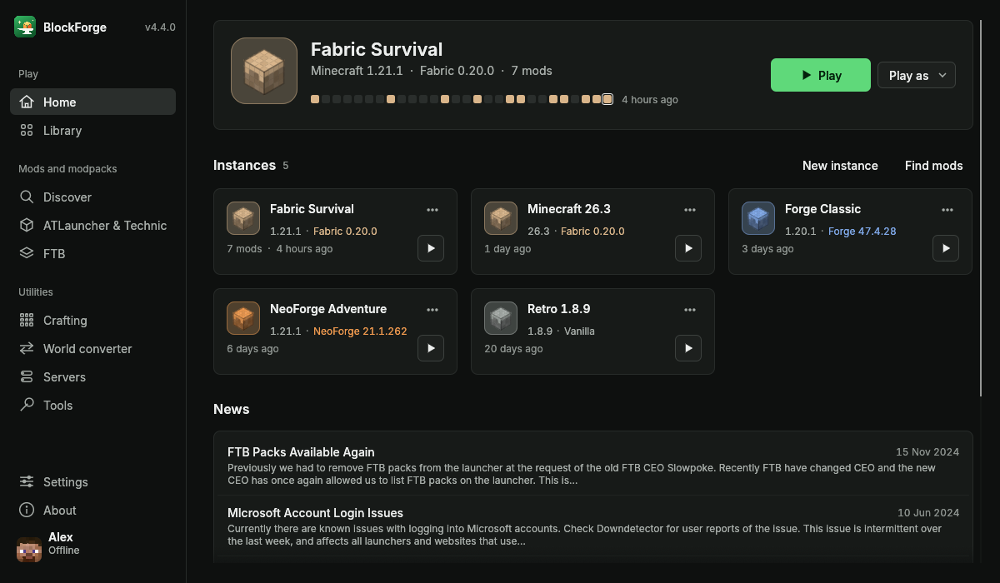
</p>

## Why BlockForge?

- **Native and fast.** The launcher is a single small Rust program: no Java to start up first, so the window is there in
  a fifth of a second. Minecraft itself still runs on Java, and BlockForge downloads the right Java for each game for
  you.
- **Play offline, no account needed.** Type any name and play, pick a saved player, or sign in with Microsoft. Signing in
  is optional.
- **Every modpack source in one place.** ATLauncher, CurseForge, Modrinth, FTB and Technic packs, or any Minecraft version
  with Fabric, Quilt, Forge or NeoForge.
- **Mods, resource packs and shaders** with one-click installs from Modrinth and CurseForge, automatic dependencies,
  update checks, switch-off and a safety scan before the game starts.
- **Bring your instances.** Imports from Prism, MultiMC, CurseForge, GDLauncher and ATLauncher, and exports to Modrinth,
  CurseForge and MultiMC formats.
- **Set up for your PC automatically.** Game memory is picked from your RAM, free memory and cores and from the game
  (version, loader, number of mods, shaders, what the pack asks for), or you set your own amount, for everything or per
  instance. Light mode switches on by itself on older computers.
- **Smoother games on any loader.** Two small helpers start with the game: Fast start (opens it sooner) and the
  smoothness helper (small fixes inside the game). They are not mods, so they work the same with vanilla, Fabric, Quilt,
  Forge and NeoForge. **Low-end mode** lowers the graphics settings of games on a slow computer (on by itself when the
  computer looks slow) and puts your own settings back when you switch it off. Each can be switched off in
  Settings > Game and for each instance on its own.
- **A crafting calculator.** Pick an item and an amount and the Crafting page lists what to gather, what to craft or
  smelt in order, the fuel, and how many chests it takes, using the recipes of your own Minecraft files, so every
  version from 1.13 on works.
- **World conversion.** Bedrock Edition worlds to Java Edition, and only that way. The Tools page has a Convert a
  Bedrock world screen (a world folder, or a `.mcworld` or `.zip`, to a Java world from 1.13 to the newest version), and
  an instance has an Add a Bedrock world button that converts the world straight into its saves folder, so it shows
  up in Singleplayer. World conversion is powered by a Rust port of [Chunker](https://github.com/HiveGamesOSS/Chunker) by Hive Games (MIT). The original
  world is never changed. See [Credits and license](#credits-and-license).
- **Real desktop citizen.** Menu entries, icons and shortcuts on every system, a tray icon, a console window, light and
  dark themes, skins with a preview, backups, and drag and drop of mods, packs and instances.
- **Private by default.** No usage statistics and no crash reports exist in BlockForge. See [PRIVACY.md](PRIVACY.md).
- **Updates itself, in one click.** BlockForge checks its GitHub releases and installs the new version in the way that
  fits how you installed it.

## Screenshots

<table>
  <tr>
    <td width="50%"><br><sub>Home: continue where you left off, with a strip of the days you played</sub></td>
    <td width="50%">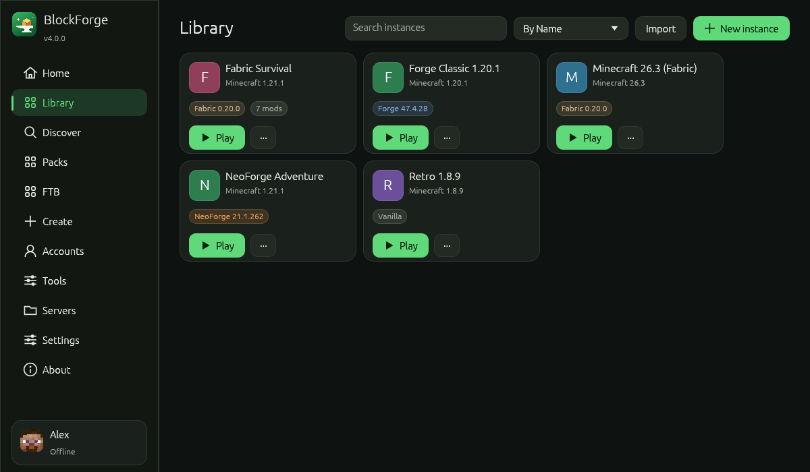<br><sub>Library of your instances</sub></td>
  </tr>
  <tr>
    <td width="50%">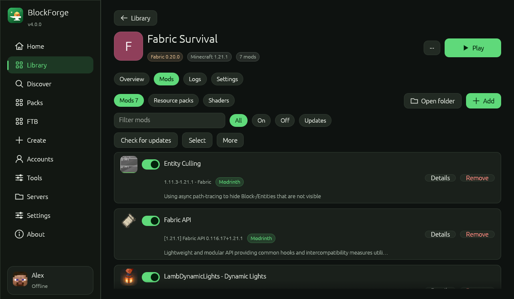<br><sub>Mods with icons, updates and one-click switches</sub></td>
    <td width="50%">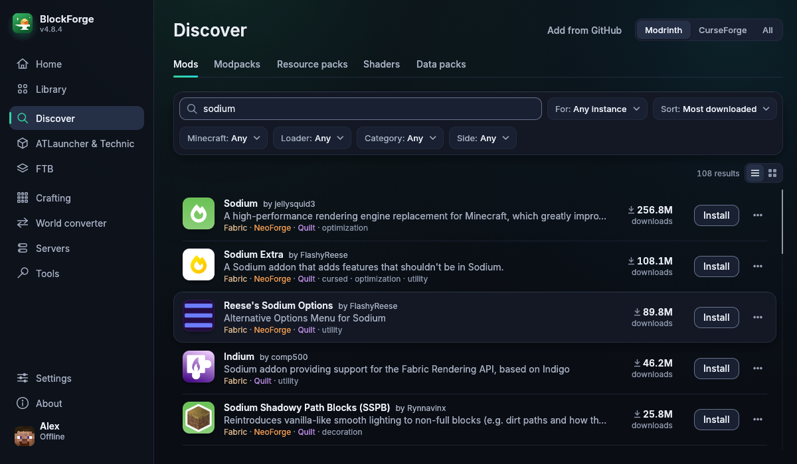<br><sub>Find mods on Modrinth or CurseForge</sub></td>
  </tr>
  <tr>
    <td width="50%">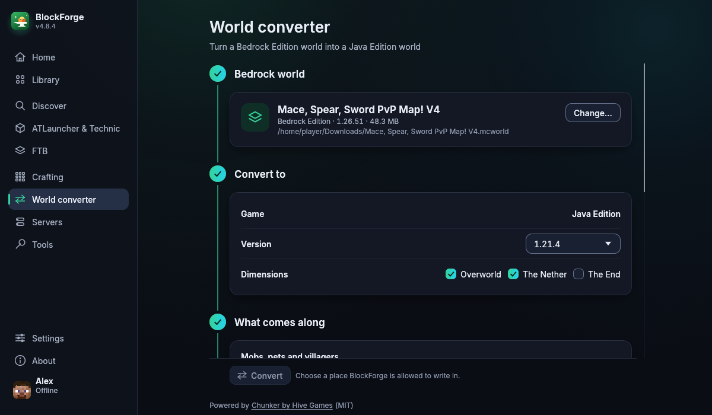<br><sub>World converter: Bedrock to Java</sub></td>
    <td width="50%">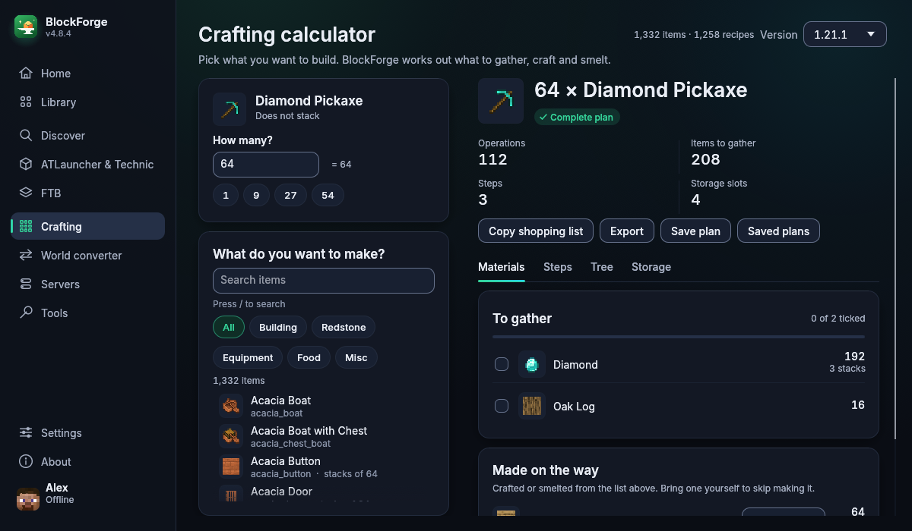<br><sub>Crafting calculator: what to gather and craft</sub></td>
  </tr>
</table>

<details>
<summary>More screenshots</summary>

<table>
  <tr>
    <td width="50%">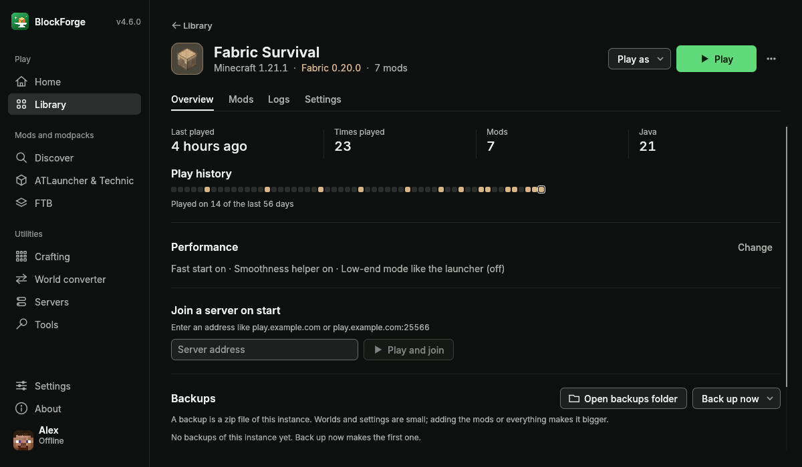<br><sub>One instance: facts, play history and backups</sub></td>
    <td width="50%">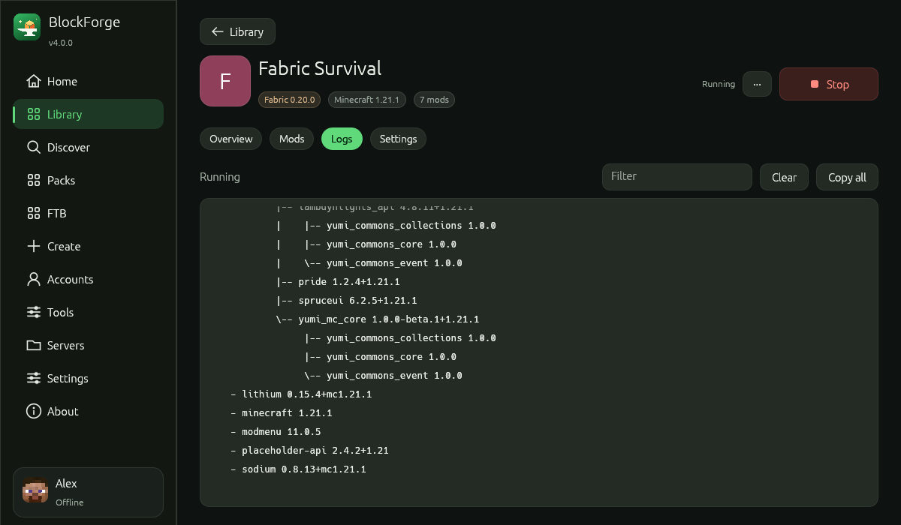<br><sub>The game's log, live, with filter and copy</sub></td>
  </tr>
  <tr>
    <td width="50%">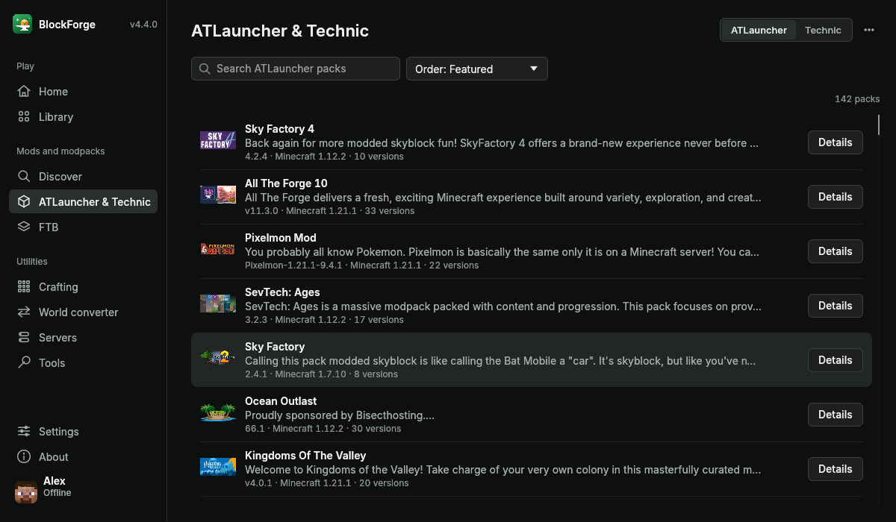<br><sub>ATLauncher and Technic modpacks</sub></td>
    <td width="50%">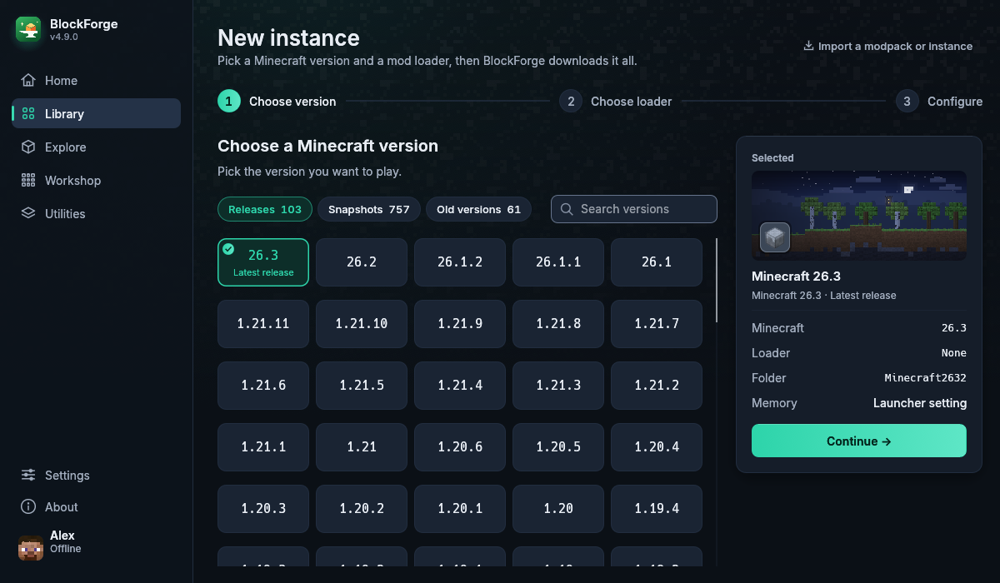<br><sub>New instance with any version and mod loader</sub></td>
  </tr>
  <tr>
    <td width="50%">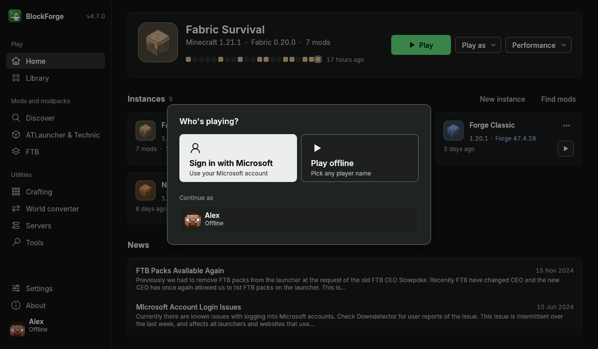<br><sub>Who's playing: an offline name or Microsoft</sub></td>
    <td width="50%">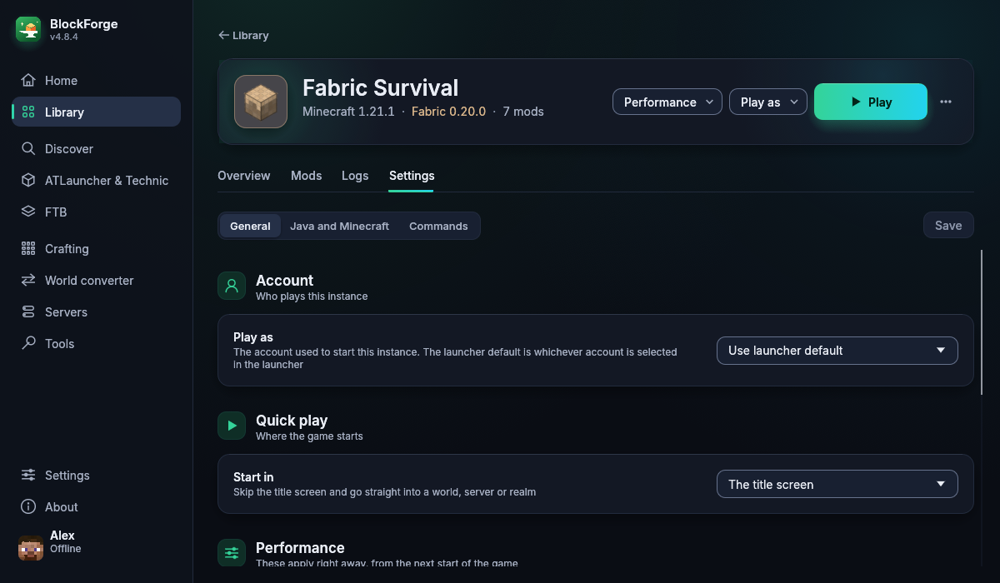<br><sub>Settings of one instance: memory, Java, commands</sub></td>
  </tr>
  <tr>
    <td width="50%">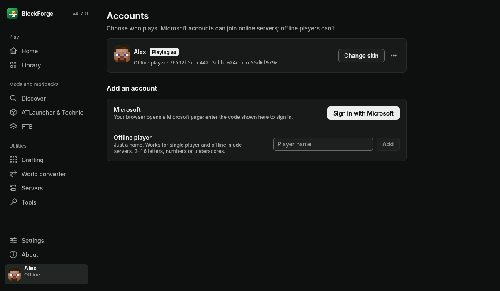<br><sub>Accounts</sub></td>
    <td width="50%">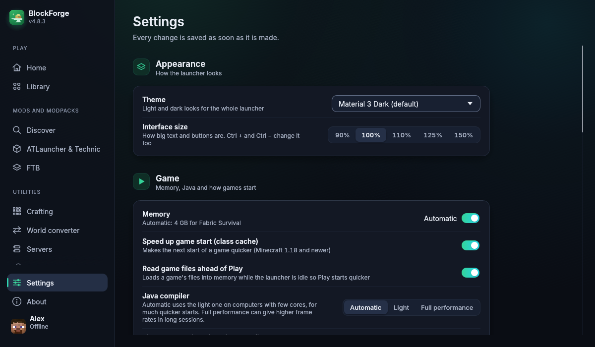<br><sub>Settings</sub></td>
  </tr>
  <tr>
    <td width="50%">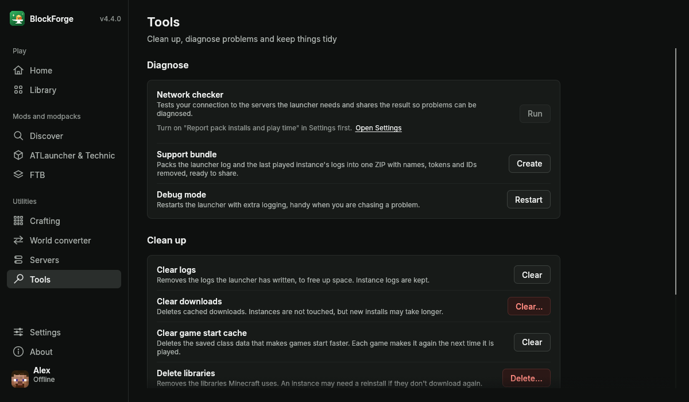<br><sub>Tools: network checker, support bundle, clean-up</sub></td>
    <td width="50%">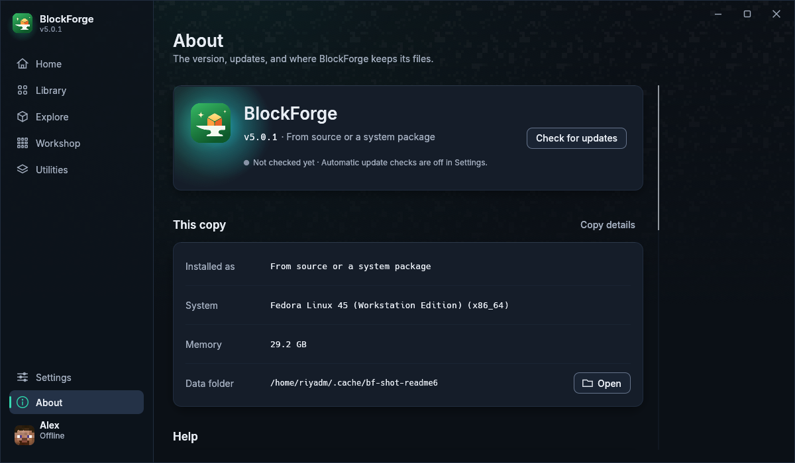<br><sub>About: version, update check and credits</sub></td>
  </tr>
  <tr>
    <td width="50%">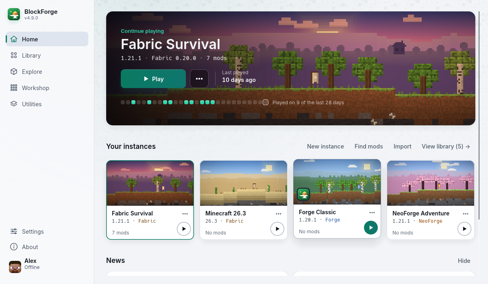<br><sub>Home in the light look</sub></td>
    <td width="50%">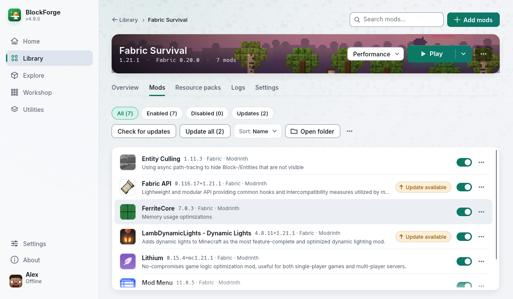<br><sub>Mods in the light look</sub></td>
  </tr>
</table>

</details>

## BlockForge compared with ATLauncher

The numbers below were measured on one computer (Fedora Linux, 16 cores, 30 GB of memory), starting each launcher on a
copy of the same settings and the same instance, alternating the two programs, four runs each. The window time is the
time from starting the program to its main window being on screen; memory is the resident memory 15 seconds after that.
Your numbers will differ; the proportions are what matter. The original is ATLauncher 3.4.41.3 (the Java program).

| | ATLauncher 3.4.41.3 | BlockForge 4.0 | Difference |
|---|---|---|---|
| Time to the main window (median) | 2.31 s | 0.18 s | **92% faster** (about 13 times) |
| Memory with the window open (median) | 244 MB | 101 MB | **59% less** |
| CPU while idle | 0.0% | 0.0% | same |
| Needs Java installed to run the launcher | yes | no | |
| Download size | 27.5 MB (Windows exe) or 27.1 MB (jar), and Java has to be installed | 8.2 MB (Windows setup), 9.1 MB (macOS), 8.0 MB (deb), 7.8 MB (rpm), 11.3 MB (AppImage) | **about 70% smaller**, and nothing else to install |

What does not change: Minecraft itself. It runs on the same Java in both launchers, so the time from pressing Play to the
title screen is dominated by the game and your mods (about 7 to 8 seconds for Fabric 1.21.1 and 26.3 on the test
computer). BlockForge's own preparation before the game starts takes 25 to 40 milliseconds.

Other differences:

| | ATLauncher | BlockForge |
|---|---|---|
| Play offline | needs a Microsoft account | any name, no account needed |
| Updates | its own servers | BlockForge's GitHub releases, one click |
| Usage statistics and play-time reporting | on by default | do not exist |
| Installers | Windows exe, jar | Windows installer, macOS disk image, deb, rpm, AppImage |

## Download and install

Get the newest version from the [**Releases** page](https://github.com/riyadmondol2006/BlockForge/releases/latest). The
`nightly` prerelease always holds the newest build from `main`, and every push also leaves its builds under **Actions**
(open a run, then **Artifacts**).

| System | File | How |
|---|---|---|
| Windows 10 and 11 (64-bit) | `BlockForge-<version>-windows-x64-setup.exe` | Run it. It installs for your user, no administrator needed, and adds a Start menu entry and an optional desktop shortcut. A newer setup replaces the older install. |
| Windows, no install | `BlockForge-<version>-windows-x64-portable.zip` | Unzip it anywhere and run `blockforge.exe`. |
| macOS on Apple Silicon (M1 and newer) | `BlockForge-<version>-macos-arm64.dmg` | Open it and drag BlockForge to Applications. The app is not signed with an Apple developer certificate, so on first start go to System Settings > Privacy & Security and choose **Open Anyway** (older macOS: right-click the app and choose Open). |
| Debian, Ubuntu and relatives | `BlockForge-<version>-linux-x86_64.deb` | `sudo apt install ./BlockForge-*.deb` |
| Fedora, RHEL, openSUSE and relatives | `BlockForge-<version>-linux-x86_64.rpm` | `sudo dnf install ./BlockForge-*.rpm` |
| Any other Linux | `BlockForge-<version>-linux-x86_64.AppImage` | `chmod +x` it and run it. It adds itself to your applications menu the first time. |

`SHA256SUMS.txt` next to them lists the checksum of every file. The Windows setup is not code-signed yet: choose **More
info** and then **Run anyway** if SmartScreen asks.

Not built yet: Intel Macs, Windows on ARM and Linux on ARM.

### Updating

BlockForge checks for a new version a few seconds after it opens and every six hours after that (turn it off in
**Settings**, or press **Check for updates** on the **About** page). When there is one, a banner offers **Update now**
and installs it the way your copy was installed: the AppImage is replaced in place, deb and rpm go through your package
manager, the Windows setup replaces the install, and the macOS disk image opens for you.

### Coming from an older BlockForge (3.x, the Java version) or ATLauncher

- **Installed copies of BlockForge 3.x** (Windows installer, macOS disk image, deb, rpm): press the update button in the
  old launcher, or install the new package or setup over the old one. The new Windows setup finds the old Java install
  and removes it first; the deb and rpm replace the old package. Your instances, accounts and settings stay where they
  are, because BlockForge 4 uses the same folder and the same file formats.
- **The plain `.jar` of BlockForge 3.x**: it is no longer built. Install the setup, disk image or package for your
  system from the releases page; your data stays in the same folder.
- **ATLauncher**: BlockForge keeps its own folder. Use **Import** to copy an ATLauncher instance in; nothing is moved or
  changed in ATLauncher's folder.

### Where BlockForge keeps its files

| System | Folder |
|---|---|
| Linux | `~/.local/share/blockforge` |
| Windows | `%APPDATA%\BlockForge` |
| macOS | `~/Library/Application Support/BlockForge` |

Open it from **About > Open data folder**. Set the `BLOCKFORGE_DIR` environment variable to use another folder.

## Command line

The same program also works from a terminal:

```sh
blockforge list                                       # your instances
blockforge versions                                   # Minecraft versions
blockforge create "Survival" --mc 1.21.1 --loader fabric
blockforge launch Survival                            # start it (add --dry-run to only print the command)
blockforge account offline Steve                      # add an offline player
blockforge search sodium --mc 1.21.1 --loader fabric  # search Modrinth
blockforge add Survival sodium                        # install a mod with what it needs
blockforge import MyPack.mrpack                       # create an instance from a modpack
blockforge --help
```

Give it a modpack or instance file instead of a command (`blockforge MyPack.mrpack`) and it opens the window on the
import screen, which is what double-clicking a `.mrpack` does.

## What changed from ATLauncher

- **Rewritten in Rust** with a new window written from scratch: sidebar navigation, Material-style dark and light looks,
  18 themes, and vector icons.
- **Offline players** are built in, and any account can be picked for a game with the Play as button next to Play, and several games can run at once.
- **Performance helpers**: Fast start, the smoothness helper and Low-end mode (Settings > Game > Performance, and a
  switch on every instance), for every mod loader. If a game closes early with a helper on, BlockForge offers to turn
  them off, and switches the smoothness helper off by itself after two early closes in a row.
- **Crafting calculator** (the Crafting page): materials, steps, tree and storage for any item, with your own stock,
  saved plans and a shopping list to copy.
- **Graphics card choice** for laptops with two cards (Settings > Game > Graphics card): power saving, high
  performance, or a card by name on Linux.
- **One mods manager** per instance, with updates, dependencies, switch on and off, and a scan for known malicious mods
  before the game starts.
- **Memory and Java chosen for you**: automatic game memory sized to your PC and the game, the right Java downloaded
  from Mojang for each version, and a class cache that speeds up later starts.
- **Nothing is collected.** The usage statistics, pack-install reporting and crash reporting are gone.
- **Its own updater** that checks BlockForge's releases, instead of ATLauncher's.
- **Installers for every system** with proper shortcuts, and one-click updates.
- New name, logo and data folder, so it never mixes with an existing ATLauncher install.

## Building from source

You need the stable [Rust toolchain](https://rustup.rs) (1.88 or newer).

```sh
git clone https://github.com/riyadmondol2006/BlockForge
cd BlockForge
cargo run --release            # the launcher window
cargo test --release           # about 600 tests, a few seconds
```

Packages are built by the scripts in [`packaging/`](packaging/) and by the
[GitHub workflow](.github/workflows/build.yml), which builds, tests and publishes everything on every push to `main`. A push that changes the program raises the version
by itself (see `.github/scripts/version.sh`: `[skip bump]` in a commit message skips it, `[minor]` or `[major]` raises
that part).
See [CONTRIBUTING.md](CONTRIBUTING.md) for how the code is laid out and [TESTING.md](TESTING.md) for how to try it.

## Known limits

- The Windows setup and the macOS app are not code-signed, so the system asks you to confirm the first start.
- Minecraft versions older than 1.6 start through a small Java wrapper (`legacy-launch`), as in ATLauncher.
- ATLauncher server packs are only partly supported (vanilla, Fabric and Forge up to 1.12.2).

## Credits and license

BlockForge is free software under the [GNU General Public License v3](LICENSE). It is built on the work of
[ATLauncher](https://github.com/ATLauncher/ATLauncher) and its contributors; see [NOTICE.md](NOTICE.md) for the full
credits and third-party licenses. "Minecraft" is a trademark of Mojang AB.

World conversion is a Rust port of [Chunker](https://github.com/HiveGamesOSS/Chunker) by Hive Games, which is
distributed under the MIT License (Copyright (c) 2024 Hive Games). The license text is in [NOTICE.md](NOTICE.md), the
files derived from Chunker say so in their header, and the Convert screen and the About page credit it. BlockForge is
not affiliated with or endorsed by Hive Games.
